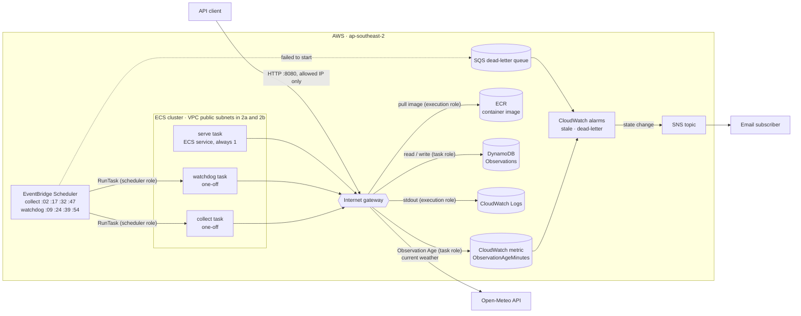

# local-weather-aws

Collects the current weather for Mudgeeraba, QLD from [Open-Meteo](https://open-meteo.com/) and stores it in DynamoDB. The aim is a stack that runs on ECS Fargate, scheduled by EventBridge Scheduler, and is created and destroyed with Terraform.

Domain terms (Location, Observation, Slot, Session, Watchdog) are defined in [CONTEXT.md](CONTEXT.md). Architectural decisions are in [docs/adr](docs/adr).

## Status

- [x] Collector fetches the current Observation from Open-Meteo
- [x] Observations stored in DynamoDB (local)
- [x] API: `/health`, `/latest`, `/history`
- [x] Watchdog: computes Observation Age (publishing to CloudWatch comes with the alarms)
- [x] Container image (arm64, runs `serve`, `collect` or `check`)
- [x] Terraform: DynamoDB, ECR (image pushed by hand)
- [x] ECS Fargate task, run by hand (`make run-collect`)
- [x] ECS service keeping the API running (port 8080, your IP only)
- [x] EventBridge Scheduler runs collect every 15 minutes, with a dead-letter queue
- [x] Watchdog publishes Observation Age to CloudWatch every 15 minutes; alarms email through SNS
- [x] `make up` / `make down`
- [ ] CI: typecheck, tests and `terraform validate` on every push

## How it fits together



**What happens every 15 minutes**

| Time | What | Result |
|---|---|---|
| :00 | A new Open-Meteo Slot opens | |
| :02 | Scheduler starts a **collect** task | Fetches the Slot and writes an Observation to DynamoDB, then stops |
| :09 | Scheduler starts a **watchdog** task | Measures Observation Age (about 9 when healthy) and publishes it to CloudWatch, then stops |
| always | **serve** answers `/latest` and `/history` | Reads DynamoDB |
| every minute | The **stale alarm** checks the newest Observation Age | Over 35 minutes → email; no readings at all → email; back to normal → email |

Each scheduled run is a brand-new Fargate task with its own network card and public IP. Only serve stays running.

**Who is allowed to do what**

| Role | Used by | Allows | If it's wrong |
|---|---|---|---|
| Execution role | ECS, starting any task | Pull the image from ECR, write logs | Task never starts; stuck pulling the image |
| Task role | Your code, while it runs | DynamoDB on the one table; publish metrics to `LocalWeather` | Task starts, then fails with `AccessDeniedException` |
| Scheduler role | EventBridge Scheduler | Start tasks, hand them the two roles above (`iam:PassRole`), write to the dead-letter queue | No task starts; the reason lands in `make dlq` |

**Where to look when something's off**

| Symptom | Check |
|---|---|
| No new Observations | `make dlq` (scheduler couldn't start it), then `make logs` (it started and failed) |
| `make aws-*` hangs | Your IP changed; run `make tf-apply` to update the firewall rule |
| No alarm emails | Click the SNS confirmation email; it's needed every Session |
| Task stuck in PENDING, then stopped | It can't pull the image: check the image tag was pushed (`make ecr-images`) |

## Prerequisites

- Docker (the app and DynamoDB Local both run in containers)
- Node 22.18+ and npm, for typechecking and editor support
- AWS CLI, for inspecting tables
- jq, for pretty-printing API responses
- Terraform 1.10+ and an AWS CLI profile named `weather`, for the AWS targets (see [AWS](#aws))

## Local development

Everything runs in Docker, using the same image ECS runs. `app/src` is mounted into the container, so code changes take effect without a rebuild.

```sh
make install     # npm install in app/ (editor + typecheck)
make image       # build local-weather:dev (again after changing dependencies or the Dockerfile)
make local       # start DynamoDB Local and create the table
make collect     # fetch and store one Observation
make check       # Watchdog: print Observation Age
make serve       # API on :8080, restarts when src/ changes
make latest      # in another terminal: GET /latest
make local-down  # stop DynamoDB Local (data is in-memory and is discarded)
```

Container config lives in [`app/local.env`](app/local.env). `DYNAMODB_ENDPOINT` points the SDK at the `dynamodb` Compose service; in AWS it is unset, and credentials come from the ECS task role.

### Make targets

| Target | Does |
| --- | --- |
| `install` | `npm install` in `app/` |
| `typecheck` | Typecheck the app |
| `test` | Run the tests in the container (unit tests plus the store against DynamoDB Local) |
| `image` | Build the arm64 image `local-weather:dev` |
| `local` | Start DynamoDB Local and create the table |
| `local-down` | Stop DynamoDB Local |
| `collect` | Fetch the current Observation and store it |
| `check` | Run the Watchdog: print Observation Age |
| `serve` | Run the API with `--watch` |
| `health` / `latest` / `history` | Call the local API (`make history HOURS=2`) |
| `db-scan` | Every item in the table, raw DynamoDB format |
| `db-latest` | Newest Observation for the Location |
| `db-history` | All Observations for the Location, newest first |

## Container

One image runs every mode; the command picks which one:

| Mode | Command | In AWS |
| --- | --- | --- |
| serve | `node src/serve.ts` (default) | ECS service |
| collect | `node src/collect.ts` | Scheduled task |
| check | `node src/check.ts` | Scheduled task (Watchdog) |

Node runs the TypeScript directly, so there is no build step and the image contains `src/` as written. It is built for `linux/arm64` to match Graviton Fargate.

## Code layout

```
app/
├── src/
│   ├── collect.ts               entrypoint: fetch an Observation and store it
│   ├── check.ts                 entrypoint: Watchdog, measures Observation Age
│   ├── serve.ts                 entrypoint: HTTP API
│   └── lib/
│       ├── api.ts               HTTP routes (createApi), independent of where data comes from
│       ├── observationAge.ts    Observation Age calculation
│       ├── openMeteoClient.ts   client: Open-Meteo API
│       ├── observationStore.ts  store: Observations table in DynamoDB
│       ├── observation.ts       type: Observation
│       ├── location.ts          type: Location, read from env
│       └── env.ts               config helpers
├── scripts/
│   └── create-local-table.ts    creates the table in DynamoDB Local
├── test/                        node:test suites, mounted into the container (not in the image)
└── local.env                    container config for local runs
```

Naming: `*Client.ts` talks to an external API, `*Store.ts` reads and writes a table, plain nouns are types. Entrypoints only wire these together.

## AWS

Everything in AWS is created and destroyed together; a Session is the time between the two. Nothing is left running in between.

### One-time setup

1. An AWS account, with MFA on the root user and a monthly cost budget created in the Billing console.
2. An IAM user with console access, MFA and the `AdministratorAccess` policy. Do not enable IAM Identity Center or AWS Organizations: on a free-plan account, creating an organization switches to paid and ends the free credits.
3. A CLI profile for that user:
   ```sh
   aws configure set region ap-southeast-2 --profile weather
   aws login --profile weather
   aws sts get-caller-identity --profile weather   # Arn should end in :user/<you>
   ```
4. Copy `infra/terraform.tfvars.example` to `infra/terraform.tfvars` (gitignored) and set `alert_email`.
5. Download the Terraform providers: `make tf-init`.

`REGISTRY` in the Makefile contains the AWS account ID; change it if you use a different account.

### Starting a Session

```sh
aws login --profile weather   # if the previous login has expired
make up                       # creates ECR, pushes the image, then shows the full plan and asks
```

Then click the SNS confirmation email to receive alarms. Collect runs at :02, :17, :32 and :47, and the Watchdog at :09, :24, :39 and :54.

```sh
make logs                     # follow task logs
make aws-latest               # the newest Observation, served from AWS
make alarms                   # both alarms and their state
```

The image tag is the hash of the last commit that changed the image's inputs (`app/src`, `app/package*.json`, `Dockerfile`, `.dockerignore`). During a Session, after changing any of those: commit, `make push`, `make tf-apply`. After changing only Terraform: `make tf-apply`.

### Ending a Session

```sh
make down                     # shows what will be destroyed and asks
```

This removes everything, including ECR images, logs and Observations. Task definitions are deregistered rather than deleted, so `local-weather:<n>` stays listed as INACTIVE in the ECS console. CloudWatch metrics can't be deleted; they expire on their own.

### AWS make targets

| Target | Does |
| --- | --- |
| `up` / `down` | Start or end a Session (`up` = `preflight`, `ecr-repo`, `push`, `tf-apply`) |
| `preflight` | Check `terraform.tfvars`, the AWS login and Docker |
| `ecr-repo` | Create only the ECR repository, so there is somewhere to push |
| `tf-init` | Download the Terraform provider (once per clone) |
| `tf-plan` / `tf-apply` / `tf-destroy` | Plan, create or remove the stack, tagged with the current git SHA |
| `push` | Log in to ECR, build the arm64 image and push it |
| `ecr-images` | List image tags in the repository |
| `run-collect` | Run collect once now, instead of waiting for the schedule |
| `logs` | Follow the task logs in CloudWatch |
| `aws-db-history` | Observations in the real table |
| `ip` | Public IP of the running serve task (changes whenever the task is replaced) |
| `aws-health` / `aws-latest` / `aws-history` | Call the API in AWS (`make aws-history HOURS=2`) |
| `dlq` | Why the scheduler failed to start a task, if it has (empty means no failures) |
| `run-check` | Run the Watchdog once now, instead of waiting for :09, :24, :39 or :54 |
| `age` | Observation Age as CloudWatch has it, over the last 2 hours |
| `alarms` | Both alarms and their current state |
| `alarm-test` | Force the stale alarm into ALARM to test the email; it returns to its real state at the next check |

The API only accepts connections from the IP that ran `make tf-apply`. If your IP changes (new network, hotspot), the `aws-*` targets time out; run `make tf-apply` again to update the rule.

Terraform state is local (`infra/terraform.tfstate`, gitignored); the provider lock file is committed.

## Tests

```sh
make local   # the store tests need DynamoDB Local
make test
```

Tests use Node's built-in runner (`node:test`) and run in the container. The Open-Meteo client is tested against a mocked `fetch`, the API through `createApi` with fake data functions (no server or database), and the store against DynamoDB Local in a throwaway table that is deleted afterwards.

## API

| Route | Returns |
| --- | --- |
| `GET /health` | `{ "ok": true }` |
| `GET /latest` | Newest Observation, or `404` before the first one is collected |
| `GET /history?hours=6` | Observations from the last `hours` (default 6, max 24), newest first |

## Data model

One DynamoDB table, keyed by `location` (partition key) and `ts` (sort key, the Slot start in UTC ISO 8601). Open-Meteo's current conditions change every 15 minutes, so each Location has at most one Observation per Slot. Collecting twice in the same Slot overwrites rather than duplicates.

## Stretch goals

- Monthly budget in Terraform (one exists in the console, created by hand)
- Build and deploy from GitHub Actions with OIDC (no AWS keys)
- Private subnets with VPC endpoints instead of public IPs
- Swap the hand-written VPC and scheduler for the `terraform-aws-modules` versions
